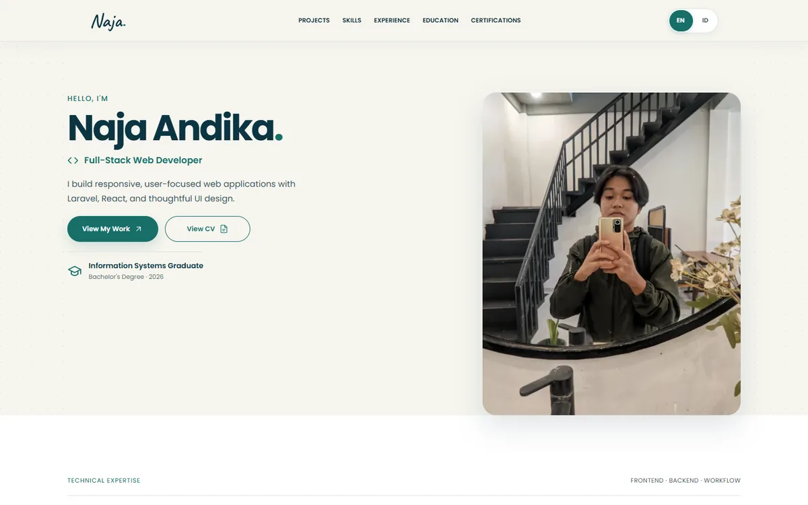

# Naja Andika — Developer Portfolio

A personal portfolio for showcasing selected web projects, technical skills, experience, education, and verified credentials. The interface combines responsive editorial layouts with lightweight interaction and motion.

**[View live portfolio](https://www.najaandika.my.id/)** · [GitHub profile](https://github.com/najaandika)



## Highlights

- Responsive, bilingual (English / Indonesian) portfolio.
- Selected projects with original visual previews and links to demos or published designs.
- Dedicated sections for skills, experience, education, and verified certifications.
- Custom tech marquee, section transitions, and interactive details.
- Accessible navigation considerations, including a skip link and reduced-motion support.

## Tech stack

| Area | Technologies |
| --- | --- |
| UI | React 19, JavaScript, Tailwind CSS |
| Tooling | Vite 8, Oxlint |
| Animation | GSAP 3 |
| Assets | Optimized WebP imagery, custom SVG icons |

## Run locally

Requirements: Node.js and npm versions compatible with the project's dependencies.

```bash
git clone https://github.com/najaandika/portfolio.git
cd portfolio
npm ci
npm run dev
```

Additional commands:

```bash
npm run build    # Production build
npm run preview  # Preview the build locally
npm run lint     # Run Oxlint
```

## Project structure

```text
src/
  components/   # Hero, navigation, skills, projects, certifications, footer
  context/      # Language provider
  data/locales/ # English and Indonesian copy
  hooks/        # Section interactions and animations
  styles/       # Portfolio styling
public/
  images/       # Optimized project imagery and portraits
  icons/        # Original technology icons
```

## About the work

This is the source for my own portfolio website. Project previews on the live site may link to separate repositories, external demos, or published UI/UX designs; a live preview does not imply that every project's source is public.

**Portfolio:** https://www.najaandika.my.id/
